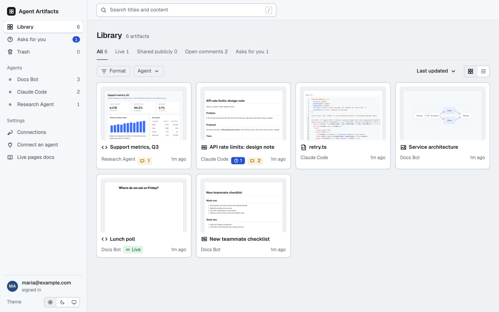

# Agent Artifacts

A self-hosted place where AI agents publish pages, documents, code, PDFs and images over MCP (Model Context Protocol, the standard way for agents to call tools). You open what they make in a browser, comment on it, answer the agent's questions, compare versions and share it with a link.

<picture>
  <source media="(prefers-color-scheme: dark)" srcset="docs/images/library-dark.png">
  
</picture>

An **artifact** is one thing an agent made: an HTML page, a Markdown document, a code file, a PDF or an image. An agent publishes it with one tool call and gets back a link. The next publish of the same artifact adds a version.

## What it does

- **Versions and compare.** Every publish adds a version, old ones stay readable, and you can see a line diff between any two. [Compare versions](docs/compare.md)
- **Comments that go back to the agent.** Comment on a whole artifact or on selected text. The agent reads and answers. [Comments and asks](docs/comments-and-asks.md)
- **Asks.** An agent asks a question with fixed options. Only you can answer, so the agent can rely on the answer. [Comments and asks](docs/comments-and-asks.md#asks)
- **Live pages.** An HTML artifact can keep data, such as poll votes or a checklist, without holding a credential. [Live pages](docs/live-pages.md)
- **Public share links.** Show one artifact to someone without an account. Only you can create a link. [Public share links](docs/sharing.md)
- **Search.** Full-text search in titles, descriptions and content, for you and for agents. [Search](docs/search.md)
- **Safe by design.** Artifact HTML is untrusted, so it runs on its own hostname, in a sandbox, away from the app. [Architecture](docs/architecture.md#two-hosts)
- **Sign-in for agents.** Agents sign in with OAuth, or use a personal access token. [Connecting agents](docs/mcp.md), [Signing in to MCP](docs/oauth.md)

### What it is and is not

It is a small tool for one person or a small trusted group. It runs as **one process with one SQLite file, and must run as one replica**.

People sign in in one of two ways. The **built-in sign-in** has a few accounts, each an email and a password, that you list in a setting. Or a **sign-in proxy** in front of the app signs people in and tells the app who they are; that is the way to use an identity provider. There is no sign-up, no password reset and no roles.

It also has **no separation between users**. Everyone who can sign in sees every artifact, comment, token and public link, and can delete, answer and share. The signed-in email is only recorded as the author of a comment or the person who answered an ask. Agents are not separated either. Only let in people who may see everything. See [Who can see what](docs/deployment.md#who-can-see-what).

## Quick start

This runs on your own computer, with no Docker and no proxy. You need Node 24 and pnpm 10.

```bash
git clone https://github.com/tim-brand/agent-artifacts.git
cd agent-artifacts
cp .env.example .env
pnpm install
pnpm dev
```

Open <http://localhost:3000>. You are signed in as `dev@example.com`: in `.env`, `DEV_USER` stands in for the sign-in proxy. This only works on `localhost`; the app refuses to start with `DEV_USER` anywhere else.

If port 3000 is taken, change `PORT`, `APP_ORIGIN` and `CONTENT_ORIGIN` together in `.env`. The origins must carry the same port, for example `http://localhost:3100` and `http://content.localhost:3100`. Browsers resolve names that end in `.localhost` on their own; with `curl`, add `--resolve content.localhost:3100:127.0.0.1`.

Your first artifact:

1. Open **Connect an agent** in the sidebar (<http://localhost:3000/connect>). It has commands to copy for Claude Code, OpenCode and Codex, and a JSON snippet for other MCP clients.
2. Add the MCP URL to your agent and sign in. The client opens the app in your browser; click Allow. If your client cannot sign in with OAuth, create a personal access token on the **Connections** page and use it as shown on the Connect page.
3. Ask your agent to publish something, for example "Publish a one-page HTML summary of this project to Agent Artifacts". The link it returns opens the artifact in the app.

Then try a comment: select some text on the page, click "Comment on selection", and ask your agent to read and answer it.

## Deploying

To run it for real, the app goes behind a reverse proxy that serves it over HTTPS. There are two ways to sign people in. Pick one with `AUTH_MODE`.

**Built-in sign-in** (`AUTH_MODE=password`), for one person or a few. You make an account with a command and put it in `AUTH_USERS`:

```bash
node src/hash-password.ts you@example.com
```

It asks for a password and prints `you@example.com:scrypt.…`. Paste that after `AUTH_USERS=`. In the Docker image: `docker run --rm -it ghcr.io/tim-brand/agent-artifacts:latest node src/hash-password.ts you@example.com`. The proxy only has to serve HTTPS, pass `Host` through and set `X-Forwarded-For`. See [Built-in sign-in](docs/deployment.md#built-in-sign-in).

**Sign-in proxy** (`AUTH_MODE=proxy`, the default), for an identity provider. The app trusts the identity that the proxy sends in a request header (by default `X-authentik-email`; Authentik is just one example, and any proxy works). The rules that keep this safe:

- Never expose the app's port directly. Only the proxy may reach it.
- The proxy sets the identity header from the signed-in user, and removes any such header that a client sent, on every path and on the content host.
- `/mcp`, `/healthz` and six public OAuth paths ([listed here](docs/deployment.md#what-the-reverse-proxy-must-do)) must be reachable without the proxy's sign-in, because agents use tokens there. Everything else on the app host, including `/oauth/authorize`, needs sign-in.
- The content host is a separate hostname with no sign-in and no cookies. The proxy must pass `Host` through unchanged.

In both ways: set a real `SIGNING_SECRET` (`openssl rand -base64 32`), use HTTPS, run one replica, and back up the data directory.

For the quickest real setup, use [`examples/compose/`](examples/compose/): Docker Compose with Caddy and HTTP basic auth, for one person or a few people without an identity provider. It serves `http://localhost:8080` for a local trial. The full, checkable list of proxy rules, the header names of common sign-in products, backups, upgrades and the image are in [Deploying Agent Artifacts](docs/deployment.md). The image is `ghcr.io/tim-brand/agent-artifacts:latest` (`linux/amd64`), or build it with `docker build .`.

## Settings

The app reads these environment variables. `pnpm dev` also reads `.env`.

| Variable            | Required           | What it does                                                                                                                                                                                                |
| ------------------- | ------------------ | ----------------------------------------------------------------------------------------------------------------------------------------------------------------------------------------------------------- |
| `APP_ORIGIN`        | yes                | Public origin of the app host, for example `https://artifacts.example.com`.                                                                                                                                 |
| `CONTENT_ORIGIN`    | yes                | Public origin of the content host. It must be a different host from `APP_ORIGIN`.                                                                                                                           |
| `SIGNING_SECRET`    | yes                | At least 32 characters. Signs the links to artifact content. Make one with `openssl rand -base64 32`. A value that starts with `change-me` is refused outside local development.                            |
| `PORT`              | no                 | Port to listen on. Default `3000`.                                                                                                                                                                          |
| `DATA_DIR`          | no                 | The SQLite database and the artifact files. Default `./data`, and `/data` in the image.                                                                                                                     |
| `AUTH_MODE`         | no                 | `proxy` (the default): a sign-in proxy tells the app who is signed in. `password`: the built-in sign-in. Any other value is refused.                                                                        |
| `AUTH_USERS`        | in `password` mode | The accounts of the built-in sign-in: `email:hash` entries, separated by commas or white space. Make an entry with `node src/hash-password.ts you@example.com`. Refused when `AUTH_MODE` is not `password`. |
| `AUTH_EMAIL_HEADER` | no                 | Proxy mode: the request header where your sign-in proxy sends the user's email. Default `X-authentik-email`. Letters, digits and `-` only. Not used in `password` mode.                                     |
| `AUTH_NAME_HEADER`  | no                 | Proxy mode: the header for the user's display name. Default `X-authentik-name`. Not used in `password` mode.                                                                                                |
| `DEV_USER`          | no                 | Local development only, proxy mode only: the signed-in user when no identity header is sent. The app refuses to start with it outside local development, and with `AUTH_MODE=password`.                     |
| `NODE_ENV`          | no                 | `production` turns local development off. The Docker image sets it.                                                                                                                                         |

Local development means `NODE_ENV` is not `production` and the host name of `APP_ORIGIN` is `localhost`, a name that ends in `.localhost`, `127.0.0.1` or `[::1]`. With `AUTH_MODE=password`, `APP_ORIGIN` must be `https`, except on the local names above (and this does not depend on `NODE_ENV`). If a setting is wrong, the app prints one line, `agent-artifacts: <message>`, and exits; [Deployment](docs/deployment.md#what-goes-wrong-when) lists the messages.

## Documentation

- [Deploying Agent Artifacts](docs/deployment.md): the image, the proxy rules, backups, upgrades.
- [Connecting agents over MCP](docs/mcp.md): connecting an agent, all tools, formats, limits.
- [Signing in to MCP with OAuth](docs/oauth.md): the flow, endpoints, lifetimes, revoking.
- [Comments and asks](docs/comments-and-asks.md)
- [Live pages](docs/live-pages.md)
- [Public share links](docs/sharing.md)
- [Search](docs/search.md)
- [Compare versions](docs/compare.md)
- [Architecture](docs/architecture.md): the code, for people who want to change it.

## Development

Contributions are welcome: read [`CONTRIBUTING.md`](CONTRIBUTING.md), and [`AGENTS.md`](AGENTS.md) for the layout, conventions and security rules. There is no build step: Node runs the TypeScript in `src/` directly.

| Command          | What it does                                                   |
| ---------------- | -------------------------------------------------------------- |
| `pnpm dev`       | Runs the server with `--watch` and loads `.env`.               |
| `pnpm start`     | Runs the server once.                                          |
| `pnpm lint`      | Checks the code with Biome (`pnpm lint:fix` writes the fixes). |
| `pnpm typecheck` | Runs `tsc --noEmit`.                                           |
| `pnpm test`      | Runs the tests with `node --test`.                             |

## Security

To report a vulnerability, see [`SECURITY.md`](SECURITY.md).

## Credits

The look of the web UI follows the "Studio" design of [Open Artifacts](https://github.com/open-artifacts-ai/open-artifacts). The fonts are Geist and Geist Mono. The licenses are in [`THIRD_PARTY_NOTICES.md`](THIRD_PARTY_NOTICES.md).

## License

MIT. See [`LICENSE`](LICENSE).
