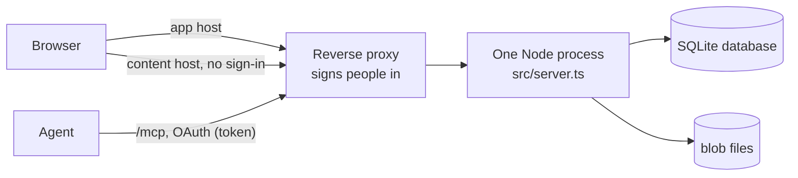

# Architecture

This page is for people who want to understand or change the code: how the two hosts work and why, how a request travels through the app, how data is stored, and how artifact pages are kept away from the app. For the coding conventions and the full list of security rules, see [`AGENTS.md`](../AGENTS.md); this page does not repeat them.

## The pieces

There is no build step. Node 24 runs the TypeScript in `src/` directly, by removing the types, so the code uses only syntax that can be removed (no enums, namespaces or parameter properties). The code is built on [Hono](https://hono.dev), and the data is in SQLite through `node:sqlite`.

| Path | What it holds |
| --- | --- |
| `src/server.ts`, `src/config.ts` | Startup and settings. |
| `src/app.ts` | Sends each request to the app host or the content host by its `Host` header. |
| `src/contracts.ts` | The service interfaces that the routes use. Change a seam here first. |
| `src/core/` | SQLite and the stored files. `db.ts` holds the migrations; one file per service (artifacts, comments, share links, data, search, library, tokens, trash, OAuth). |
| `src/mcp/` | The MCP server: stateless streamable HTTP with bearer-token sign-in. |
| `src/oauth/` | The public OAuth endpoints and their rules. |
| `src/ui/` | The web UI, rendered on the server with `hono/html`. Static files are in `src/ui/static/`. |
| `src/content/` | The content host: signed `/s/` links and public `/p/` links. `bridge.js` is the comment bridge and the live page runtime. |

## Two hosts

One process answers to two hostnames, and the `Host` header picks which one (`src/app.ts`):

- The **app host** (`APP_ORIGIN`) serves the web UI, `/mcp`, the OAuth endpoints and `/healthz`.
- The **content host** (`CONTENT_ORIGIN`) serves the files of artifacts, and nothing else.
- Any other `Host` gets a plain 404, so the UI is never reachable through a name that nobody configured. `GET /healthz` is answered before the host check, so it works on any host.

The split is the security boundary. Artifacts are written by agents and can hold HTML and scripts, so they are untrusted. A browser separates origins, so a script that runs on the content host cannot read the app's pages, cookies or API. The content host therefore sets no cookies and does no sign-in, and the app host never serves artifact content.

## A request, step by step

**App host.** The routes are tried in this order:

1. `/healthz` answers `ok`.
2. `/mcp` is the MCP server. It needs a bearer token: a personal access token (`aa_…`) or an OAuth access token issued for this endpoint. It never reads the identity headers.
3. The OAuth routes answer the six public paths (`src/oauth/rules.ts`: `PUBLIC_OAUTH_PATHS`). They read no identity headers either.
4. Everything else is the web UI (`src/ui/routes.ts`). The UI refuses the public paths itself with a 404, so it can never serve them by mistake. Then, in order: it reads the identity header (`AUTH_EMAIL_HEADER`, or `DEV_USER` in local development) and answers 401 "Not signed in" if there is none; it checks that every write has an `Origin` equal to `APP_ORIGIN`; and it limits form bodies to 64 KB. It adds the security headers (a Content-Security-Policy that allows only `'self'` and the content host for frames, `X-Frame-Options: DENY`, `Cache-Control: no-store`).

**Content host.** `/s/<exp>.<sig>/<id>/<version>/<path>` serves a file of a version. The link is signed with an HMAC-SHA256 of `id/version/exp` using `SIGNING_SECRET`, and checked in constant time; the app makes one when it renders a page, with a lifetime of one hour. `/p/<token>/…` serves a [public share link](sharing.md): the token is looked up by its hash, and the route is rate limited. `/_aa/bridge.js` is the one script the host adds (see below).

Every response from the content host carries a CSP `sandbox` (so even a page opened directly in a tab gets an opaque origin), except PDFs, which Chrome does not render in a sandbox and which only get `frame-ancestors`. Only the app origin may frame `/s/` responses, and nothing may frame `/p/` responses.

## Where identity is trusted

The identity headers are read in one place: `src/ui/`. `/mcp`, the OAuth endpoints and the content host never read them, because the proxy's sign-in is switched off on `/mcp` and the public OAuth paths, so a client could send any value there. The person's email is used for the author of comments, the answerer of asks, the user of an OAuth grant and the publisher of versions made in the UI. See [Deployment](deployment.md#what-the-reverse-proxy-must-do) for what the proxy must guarantee, and `AGENTS.md` for the rule.

## Storage

Everything is in `DATA_DIR`: `artifacts.db` and `blobs/`.

- **Blobs** are content-addressed. A file's bytes are stored once, under their SHA-256 (`blobs/ab/ab12…`), written to a temporary file and renamed into place, so a reader never sees a half-written file. Two versions, or two artifacts, with the same file share one blob. A version row lists its files with their path, size, type and hash; restoring a version copies those references and no bytes.
- **The database** has one table per concept: `artifacts`, `versions`, `version_files`, `tokens`, `share_links`, `threads`, `comments`, `asks`, `artifact_data`, a full-text table `artifacts_fts`, and the OAuth tables `oauth_clients`, `oauth_grants`, `oauth_codes` and `oauth_tokens`. It runs in WAL mode with foreign keys on.
- **Credentials** are stored only as SHA-256 hashes: personal access tokens, share link tokens, OAuth codes and tokens.
- **Deleting.** Deleting an artifact sets `deleted_at`. After 30 days an hourly job removes the row for good. Threads, comments, asks, share links and live page data reference the artifact with `ON DELETE CASCADE`, so they go with it. Then blobs that no version references and that are older than an hour are removed. The hour is a grace period for a publish that is still writing.
- **Live page data** has one row per document, with a revision number per artifact. A delete leaves a tombstone so that polling pages see it; past 1,000 tombstones they are dropped and a page that polls from before that gets a full reset.

### Migrations

The schema is a list of steps in `src/core/db.ts`. `PRAGMA user_version` records how many have run. At startup, the app runs each step that has not run yet, in order, each in its own transaction, together with the update of `user_version`. A step is either SQL or a function (for work that needs more than SQL, such as reading blobs). The list is append-only: a step that has shipped is never edited, because deployed instances already ran it. A backfill must therefore be safe on real data. If two branches add a step, the one merged second renumbers its step.

## Artifact pages and the iframe sandbox

The app shows an artifact in an `<iframe>` that points to a signed `/s/` link on the content host. The frame has `sandbox="allow-scripts allow-popups allow-popups-to-escape-sandbox allow-forms allow-downloads allow-modals"`: scripts run, but without `allow-same-origin` the page has an opaque origin, so it cannot reach the app's origin even by script. PDFs get no `sandbox` attribute for the reason above. The previews in the library are frames with `sandbox=""`, so no script runs in them at all.

### The comment bridge

On html and markdown entries opened through signed `/s/` links, the content host adds one script, `/_aa/bridge.js`, served from the content host itself. It is the only script that host adds, and public `/p/` links never get it (they get only the no-shell form of the runtime on live pages). The bridge lets the app and the page talk with `postMessage`:

- When the reader selects text, the bridge posts `{ type: 'aa:selection', exact, prefix, suffix }` to the app, which then offers "Comment on selection".
- The app sends the quotes of open threads back (`aa:highlight`), and the bridge wraps the best match of each in `<mark>`.

The app accepts a message only when `event.source` is the artifact iframe's own window (a sandboxed frame's origin is the string `"null"`, so the origin cannot be checked), and only for a message type it handles. The artifact can post anything itself, so every field is checked, and a selection does nothing until the owner clicks and submits. The bridge only posts to, and only listens to, `APP_ORIGIN`.

The UI's own browser code is `/static/app.js`, which the CSP allows (`script-src 'self'`). A new message type from the frame is added there with `onFrameMessage(type, handler)`.

### Live pages and the message channel

The bridge also defines `window.openArtifacts`. A page's calls are made by the artifact page in the app (`/static/app.js`) with `fetch` to `/api/artifacts/<id>/…` on the app host, behind the sign-in and the Origin check. The frame never sees a cookie or a token, and the artifact id comes from the page (`data-artifact` on the iframe), never from a message.

Answers carry data, and a message to a frame's window has to be posted with target origin `'*'` (its origin is opaque), so it would reach whatever document the frame shows by then, such as a site the reader clicked through to. So the app answers the frame's first `aa:ready` by transferring one end of a `MessageChannel`, and all runtime traffic goes over that port, which only that document holds and which dies with it. The app hands out one port per artifact page view: a later `aa:ready` (the frame navigated, or reloaded itself) gets `aa:no-port`, and the runtime of that page acts as if it were outside the app. The viewer is sent over the port, and only when declared. The data service checks the `db` capability on every call; the shell's own check only saves a request.

For how the features work from a user's side, see [Live pages](live-pages.md) and [Comments and asks](comments-and-asks.md).
