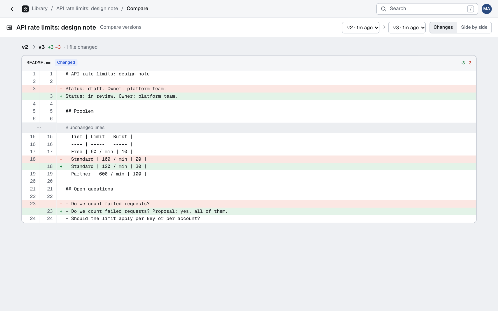

# Compare versions

This page explains how to see what changed between two versions of an artifact, in the web UI and over MCP.

<picture>
  <source media="(prefers-color-scheme: dark)" srcset="images/compare-dark.png">
  
</picture>

Each version stores how many lines its entry file adds and removes against the previous version's entry (`linesAdded`, `linesRemoved`; version 1 counts against nothing). They are counted on every publish, edit and restore, for html, markdown, code and SVG entries. For other formats, and for a diff that takes longer than half a second, they are null.

## In the web UI

- **Versions panel.** Each version shows a count such as `+18 −4`, linked to its changes against the version before it. The Compare button on the page compares the version on screen with the one before it, and the Compare button of any other version compares that one with the one on screen.
- **Compare page** (`/a/<id>/compare?from=3&to=7`; by default the latest version against the one before it). *Changes* is a unified line diff with 3 lines of context, with unchanged runs collapsed to "12 unchanged lines", rendered on the server with every line escaped. For a version with several files, it lists the files added, removed and changed, and diffs each text file; binary files are only listed. When the newer version opens another entry file and neither path is in both versions, the entry counts as renamed and is diffed against the old one.
- **Side by side** (`&mode=side`) shows both versions in two frames with the same sandbox as the artifact page. They get no runtime, so a [live page](live-pages.md)'s `db` calls there reject with `no_shell`.

## Over MCP

`compare_versions({ id, from?, to? })` returns the file changes and the unified diff as `patch` (with `--- a/path` and `+++ b/path` lines), with the same defaults as the page. To see what changed since a comment was written, pass the comment thread's `version` as `from`.

## Limits

One comparison's diff stops at 200 KB (`truncated`, in the page and over MCP), and all the diffs of one comparison get 2 seconds together. A file that does not fit is shown as too large to diff.

The diff is computed with the [`diff`](https://github.com/kpdecker/jsdiff) package (jsdiff, BSD-3-Clause, no dependencies). It uses Myers' algorithm, as git does, with a time limit per diff.
